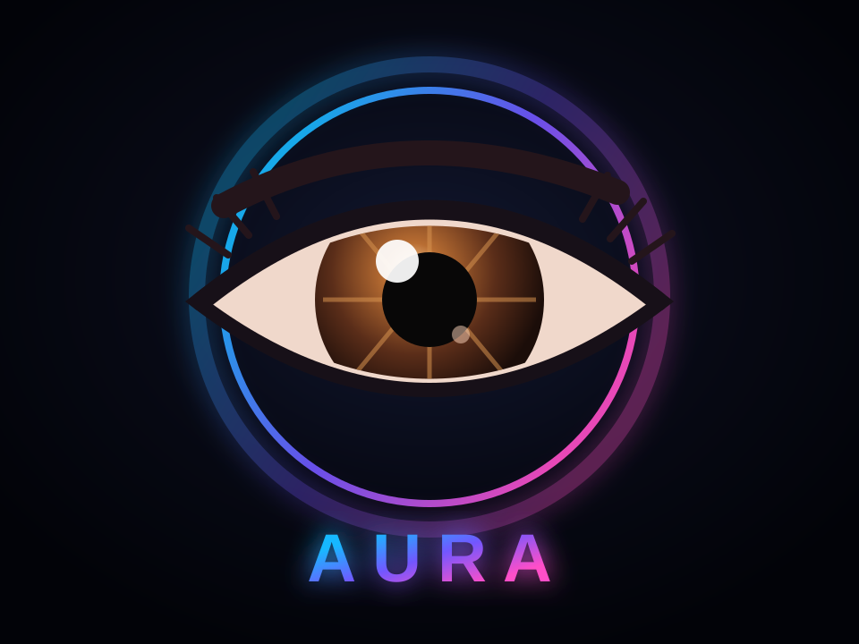

# Aura

  

<strong>A smart desktop companion built around an ESP32.</strong>

Aura combines embedded firmware, a small display, environmental sensors, ambient lighting, physical controls, and eventually a desktop companion app.

## Current status

Aura is in its initial bring-up phase.

The first milestone is intentionally small:

- verify the ESP32 development environment
- upload the first firmware
- confirm serial communication
- bring up each hardware module one at a time

## Planned hardware

- ESP32 WROOM-32 DevKit
- 1.69-inch ST7789 TFT display
- BME280 environmental sensor
- DS3231 real-time clock
- 24-LED WS2812 ring
- INMP441 I²S microphone
- rotary encoder
- passive buzzer

## Development approach

Aura is being developed as a real embedded product rather than a single experimental sketch.

The project favors:

- small, testable milestones
- one hardware bring-up at a time
- modular firmware
- clear documentation
- understanding the underlying embedded concepts instead of treating libraries as black boxes

## Tooling

- PlatformIO
- ESP32 Arduino framework
- C++
- Git

## Vision

Over time, Aura may grow into an ambient desktop interface for:

- environmental information
- notifications
- calendar and focus reminders
- GitHub and build status
- music and media state
- custom widgets
- Home Assistant integration

The goal is to create something useful, calm, expandable, and genuinely educational to build.